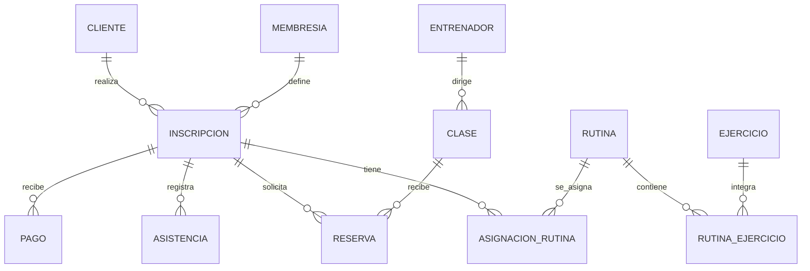

# Sustentación SQL — Fitness Planet Gym

La aplicación usa PostgreSQL 15+ mediante psycopg2, sin ORM. `app.py` conserva las consultas y `sql/schema_y_datos.sql` contiene el DDL, los datos y la lógica de integridad. Los ejemplos con `%s` son para psycopg2: se envían valores por separado y no se interpolan con `%`, f-strings o concatenaciones. En SQL Editor se pueden sustituir por literales de demostración.

## 1. Del modelo conceptual al relacional

El modelo tiene exactamente 12 tablas. Cada PK es `BIGINT GENERATED ALWAYS AS IDENTITY`: PostgreSQL genera el identificador y no acepta uno explícito sin una orden especial. Las claves de negocio, como DNI y correo, tienen `UNIQUE`; no reemplazan la clave sustituta porque podrían necesitar correcciones.

| Padre | Hijo | Clave foránea en el hijo | Cardinalidad |
| --- | --- | --- | --- |
| CLIENTE | INSCRIPCION | id_cliente | 1:N |
| MEMBRESIA | INSCRIPCION | id_membresia | 1:N |
| INSCRIPCION | PAGO | id_inscripcion | 1:N |
| INSCRIPCION | ASISTENCIA | id_inscripcion | 1:N |
| INSCRIPCION | RESERVA | id_inscripcion | 1:N |
| INSCRIPCION | ASIGNACION_RUTINA | id_inscripcion | 1:N |
| ENTRENADOR | CLASE | id_entrenador | 1:N |
| CLASE | RESERVA | id_clase | 1:N |
| RUTINA | RUTINA_EJERCICIO | id_rutina | 1:N |
| EJERCICIO | RUTINA_EJERCICIO | id_ejercicio | 1:N |
| RUTINA | ASIGNACION_RUTINA | id_rutina | 1:N |

RUTINA_EJERCICIO resuelve la relación N:M entre rutinas y ejercicios, agregando atributos de la relación (series, repeticiones, descanso). ASIGNACION_RUTINA relaciona inscripciones y rutinas a lo largo del tiempo. RESERVA vincula inscripción y clase para una fecha.



### Normalización y tipos

- Los datos de clientes, planes, entrenadores y ejercicios se guardan una vez; las operaciones referencian sus PK. Así se evita repetir nombres de planes y sus precios en cada pago.
- Las filas de las tablas puente tienen una PK técnica y una restricción de unicidad sobre la combinación de negocio. Una rutina no repite el mismo ejercicio; una inscripción no reserva dos veces la misma clase en una fecha.
- `VARCHAR2` de Oracle se adapta a `VARCHAR`; `NUMBER` entero se convierte en `BIGINT` para IDs e `INTEGER` para cantidades; dinero usa `NUMERIC(10,2)`, sin errores de punto flotante.
- DNI usa `VARCHAR(8)`: preserva ceros iniciales y no se usa para cálculos. Tiene patrón de ocho dígitos. Correo tiene unicidad adicional por `lower(correo)` para evitar duplicados por mayúsculas.
- Fechas de vigencia son `DATE`, horario recurrente es `TIME` y los instantes de pago/asistencia son `TIMESTAMPTZ`. PostgreSQL guarda el instante; la fecha comercial se calcula en Lima.
- `fecha_fin` es un dato derivado mantenido por trigger, una desnormalización controlada solicitada por el enunciado. Precio y duración de planes utilizados son inmutables para preservar el historial con estas 12 tablas.

## 2. SELECT, filtros y ordenación: buscar clientes

Consulta ejecutada en `/admin/clientes`:

```sql
SELECT * FROM cliente
WHERE %s='' OR dni=%s OR apellidos ILIKE %s
ORDER BY apellidos,nombres;
```

Los parámetros son `(busqueda, busqueda, '%' + busqueda + '%')`. Si el campo está vacío devuelve todos los clientes. DNI se compara exactamente; apellido permite coincidencias parciales sin distinguir mayúsculas mediante `ILIKE`. Los porcentajes se agregan al **valor del parámetro**, nunca al SQL. Las comillas o intentos de inyección permanecen como datos.

El índice único de DNI ayuda en la búsqueda exacta. El índice de apellidos sirve para ordenaciones y búsquedas que el planificador pueda aprovechar; un patrón con `%` al inicio no se acelera normalmente con B-tree. Para grandes volúmenes se podría agregar `pg_trgm` con GIN; no se necesita para esta demostración.

## 3. JOIN: inscripciones, cliente, plan y saldo

Consulta de inscripciones y opciones de formularios:

```sql
SELECT i.*, c.nombres || ' ' || c.apellidos AS cliente, c.dni,
       m.tipo, s.precio,s.pagado,s.saldo
FROM vw_inscripciones_estado i
JOIN cliente c USING(id_cliente)
JOIN membresia m USING(id_membresia)
JOIN vw_saldos s USING(id_inscripcion)
ORDER BY i.id_inscripcion DESC;
```

`JOIN` combina relaciones por PK/FK y evita almacenar el nombre del cliente repetido en cada inscripción. `USING` equivale a un `ON` de igualdad para columnas del mismo nombre y evita duplicarlas en la salida. La concatenación `||` solo construye una etiqueta de presentación. Orden descendente muestra primero las inscripciones más recientes por ID.

## 4. LEFT JOIN y GROUP BY: precio, pagos y saldo

Definición de `vw_saldos`:

```sql
SELECT i.id_inscripcion, m.precio,
       coalesce(sum(p.monto),0)::numeric(10,2) AS pagado,
       (m.precio-coalesce(sum(p.monto),0))::numeric(10,2) AS saldo
FROM inscripcion i
JOIN membresia m USING(id_membresia)
LEFT JOIN pago p USING(id_inscripcion)
GROUP BY i.id_inscripcion,m.precio;
```

`LEFT JOIN` conserva inscripciones que todavía no tienen pagos. `SUM` agrega los abonos de cada inscripción; `COALESCE` convierte el NULL de un conjunto sin abonos en cero. `GROUP BY` produce una fila por inscripción y precio. Un `INNER JOIN` con pago excluiría las inscripciones sin abonos y ocultaría deudas.

Ejemplo: plan de S/120, pagos de S/60 y S/20 → pagado S/80, saldo S/40. No se usa `float` para dinero ni se resta pago a pago en Python.

## 5. Vista de estado efectivo y CASE

La tabla conserva el estado registrado. La vista agrega el estado derivado:

```sql
SELECT i.*,
 CASE WHEN i.estado='CANCELADA' THEN 'CANCELADA'
      WHEN i.fecha_fin < (now() AT TIME ZONE 'America/Lima')::date THEN 'VENCIDA'
      ELSE i.estado
 END AS estado_efectivo
FROM inscripcion i;
```

Se implementa como `CREATE VIEW vw_inscripciones_estado WITH (security_invoker=true) AS ...`. Una vista normal no guarda una copia de los datos: calcula el resultado al consultar. No hace falta un proceso nocturno que actualice estados. CANCELADA tiene prioridad incluso si la fecha ya venció. El filtro real de vigencia también exige que hoy sea mayor o igual al inicio, de modo que una inscripción futura no permite ingresar.

Se utiliza `(now() AT TIME ZONE 'America/Lima')::date` como equivalente explícito de `CURRENT_DATE` en Lima. `CURRENT_DATE` sin controlar la zona depende de la conexión; en Render el servidor puede estar en UTC. `db.py` además configura `SET LOCAL TIME ZONE` dentro de cada transacción, compatible con el pooler.

## 6. Indicador: ingresos del mes

Consulta visible en el dashboard:

```sql
SELECT coalesce(sum(monto),0) AS valor FROM pago
WHERE fecha_pago >= date_trunc('month', now() AT TIME ZONE 'America/Lima') AT TIME ZONE 'America/Lima'
  AND fecha_pago < (date_trunc('month', now() AT TIME ZONE 'America/Lima') + interval '1 month') AT TIME ZONE 'America/Lima';
```

`date_trunc` obtiene el inicio del mes en Lima. Se convierte ese límite a un instante y se usa un intervalo semiabierto `[inicio, siguiente mes)`, que incluye todos los instantes del mes sin depender de la cantidad de días. A diferencia de filtrar solo por número de mes, no mezcla años diferentes. Al no transformar la columna `fecha_pago` en el filtro, el índice de fecha puede ser aprovechado.

## 7. COUNT DISTINCT: clientes activos

```sql
SELECT count(DISTINCT id_cliente) AS valor
FROM vw_inscripciones_estado
WHERE estado_efectivo='ACTIVA'
  AND (now() AT TIME ZONE 'America/Lima')::date BETWEEN fecha_inicio AND fecha_fin;
```

Cuenta personas, no contratos: si un cliente tiene dos inscripciones activas solo se cuenta una vez. `BETWEEN` incluye ambos extremos. Una cancelada o futura no se considera activa para este indicador.

## 8. Rango de fechas: próximos vencimientos

```sql
SELECT count(*) AS valor FROM vw_inscripciones_estado
WHERE estado_efectivo='ACTIVA'
  AND fecha_inicio <= (now() AT TIME ZONE 'America/Lima')::date
  AND fecha_fin BETWEEN (now() AT TIME ZONE 'America/Lima')::date
                   AND (now() AT TIME ZONE 'America/Lima')::date + 7;
```

Cuenta **inscripciones** vigentes que vencen desde hoy hasta dentro de siete días, ambos extremos incluidos. No cuenta futuras aunque finalicen dentro del rango. Los badges del panel usan la misma interpretación de fechas.

## 9. GROUP BY: asistencia por día de la semana

```sql
SELECT extract(isodow FROM fecha_hora_ingreso AT TIME ZONE 'America/Lima')::int AS dia,
       count(*) AS total FROM asistencia
WHERE fecha_hora_ingreso >= (((now() AT TIME ZONE 'America/Lima')::date - 27)::timestamp AT TIME ZONE 'America/Lima')
  AND fecha_hora_ingreso <= now()
GROUP BY dia ORDER BY dia;
```

`isodow` devuelve 1=lunes hasta 7=domingo; así se ordena cronológicamente y no alfabéticamente. Se agrupan los últimos 28 días calendario, incluido hoy hasta el instante actual. Python completa con cero los días sin filas para representar las siete barras. Se cuentan ingresos, no personas únicas: una persona puede entrar más de una vez.

## 10. JOIN + GROUP BY + ORDER BY: clase más reservada

```sql
SELECT c.nombre, count(r.id_reserva) AS total FROM clase c
JOIN reserva r ON r.id_clase=c.id_clase
WHERE r.estado <> 'CANCELADA'
GROUP BY c.id_clase,c.nombre
ORDER BY total DESC,c.nombre LIMIT 1;
```

La agrupación por ID distingue clases que podrían tener el mismo nombre. Se excluyen canceladas, y las pendientes cuentan porque ocupan cupo. `ORDER BY ... DESC` coloca primero el mayor conteo; el nombre resuelve empates de manera estable para mostrar una sola clase. El indicador es histórico de todas las fechas, incluidas reservas futuras; no es solo del mes.

## 11. Calendario: LEFT JOIN, agregación condicional y cupos

```sql
SELECT c.*, e.nombres || ' ' || e.apellidos AS entrenador,
       count(r.id_reserva) FILTER (WHERE r.estado <> 'CANCELADA') AS ocupados,
       c.capacidad-count(r.id_reserva) FILTER (WHERE r.estado <> 'CANCELADA') AS disponibles
FROM clase c JOIN entrenador e USING(id_entrenador)
LEFT JOIN reserva r ON r.id_clase=c.id_clase AND r.fecha_reserva=%s
GROUP BY c.id_clase,e.id_entrenador
ORDER BY c.horario,c.nombre;
```

El parámetro es la fecha seleccionada. La condición sobre la fecha está en `ON`, para conservar clases sin reservas. Si se colocara en `WHERE` podría eliminar las filas sin coincidencias y romper la finalidad del `LEFT JOIN`. `FILTER` limita el conteo sin eliminar la clase. Las PK agrupadas permiten seleccionar los demás atributos dependientes de cada clase y entrenador en PostgreSQL.

## 12. Funciones y triggers: fin de inscripción

`calcular_fin()` consulta `duracion_dias` mediante `SELECT ... INTO STRICT` y asigna:

```sql
-- Fragmento de la función; NEW es la fila que se va a guardar.
NEW.fecha_fin := NEW.fecha_inicio + dias;
```

El trigger `inscripcion_fin` es `BEFORE INSERT OR UPDATE FOR EACH ROW`. PostgreSQL calcula el fin aun si alguien escribe directamente desde SQL Editor. El formulario no decide el precio ni envía una fecha de fin confiable. Cambiar la fecha de inicio o el plan en una inscripción existente está prohibido; se crea otra inscripción. Un intento de alterar solo el fin se recalcula.

Por la regla literal del enunciado, duración 30 y extremos inclusivos dan 31 fechas con acceso potencial. Se documenta esta decisión para que sea revisable y no una corrección silenciosa del modelo.

## 13. Trigger de vigencia para asistencia

`validar_asistencia()` bloquea la inscripción con `SELECT ... FOR UPDATE`, comprueba estado ACTIVA, vigencia hoy en Lima y fecha del ingreso dentro del período. Si falla, ejecuta `RAISE EXCEPTION ... USING ERRCODE='23514'` (violación de CHECK/regla de negocio).

El formulario solo acepta DNI. Flask busca una inscripción activa y vigente, priorizando el fin más lejano. Después inserta la asistencia en la misma transacción; el trigger vuelve a validar incluso si la petición proviene de otro cliente SQL. Los errores se muestran como mensajes, sin exponer trazas ni credenciales.

## 14. Trigger de cupos y concurrencia

`validar_reserva()` ejecuta estos pasos:

1. Impide mover una reserva existente a otra inscripción, clase o fecha; se cancela y crea otra.
2. Obtiene `capacidad` y bloquea la fila de CLASE con `FOR UPDATE`.
3. Permite cancelación sin exigir vigencia actual, para poder liberar reservas antiguas.
4. Exige inscripción ACTIVA vigente hoy y en la fecha reservada, que no puede ser pasada.
5. Cuenta reservas no canceladas de clase + fecha, excluyendo el ID de la propia fila al actualizar.
6. Rechaza la operación si `ocupados >= capacidad`.

El bloqueo de la fila de clase hace esperar a la segunda transacción. Bajo el aislamiento predeterminado READ COMMITTED, la función de trigger vuelve a consultar el conteo después de que la primera confirma. Sin ese bloqueo, dos usuarios podrían leer simultáneamente un cupo libre y ambos reservarlo. El bloqueo es por clase, por lo que también serializa fechas diferentes de esa clase: una elección conservadora para este volumen.

`proteger_capacidad()` evita reducir una clase por debajo del máximo ocupado en cualquier fecha. El trigger de cupos también se ejecuta cuando una reserva CANCELADA vuelve a CONFIRMADA. El `UNIQUE(id_inscripcion,id_clase,fecha_reserva)` evita duplicados y Flask usa `INSERT ... ON CONFLICT ... DO UPDATE` para reactivar la misma reserva.

## 15. Trigger de pagos y transacciones

`validar_pago()` bloquea la fila INSCRIPCION con `FOR UPDATE`, obtiene el precio mediante JOIN y calcula:

```sql
-- Fragmento dentro del trigger; NEW identifica el nuevo pago.
SELECT coalesce(sum(monto),0) INTO pagado FROM pago
WHERE id_inscripcion=NEW.id_inscripcion AND id_pago <> NEW.id_pago;
```

Excluir el pago actual permite validar también UPDATE. Si `pagado + NEW.monto > precio_plan`, se lanza una excepción con el saldo. Mover un pago a otra inscripción está prohibido. El bloqueo de la inscripción serializa pagos simultáneos, incluyendo el primer abono cuando aún no hay filas en PAGO.

Flask hace una validación anticipada del saldo con el mismo bloqueo y el trigger actúa como última garantía. `Decimal` evita redondeos binarios. `db.transaction()` confirma el bloque si todo termina bien y ejecuta rollback al fallar. Crear una rutina y todos sus ejercicios también es atómico: nunca queda media rutina si un ejercicio es inválido.

## 16. Subconsultas y HAVING

`proteger_membresia()` usa una subconsulta correlacionada para detectar referencias:

```sql
-- Fragmento del trigger; OLD corresponde al plan que se intenta modificar.
EXISTS (SELECT 1 FROM inscripcion WHERE id_membresia=OLD.id_membresia)
```

`EXISTS` responde si hay al menos una inscripción; no necesita devolver sus datos. Si existe alguna, se impide modificar precio/duración y se conserva la deuda original.

`proteger_capacidad()` aplica otra subconsulta con agrupación:

```sql
-- Fragmento del trigger de CLASE.
EXISTS (
 SELECT 1 FROM reserva
 WHERE id_clase=OLD.id_clase AND estado <> 'CANCELADA'
 GROUP BY fecha_reserva HAVING count(*) > NEW.capacidad
)
```

`WHERE` filtra filas antes de agrupar; `HAVING` filtra grupos por un valor agregado. Se detecta cualquier fecha con más reservas que la capacidad propuesta.

## 17. Restricciones, borrados e índices

- `NOT NULL` asegura datos obligatorios. `CHECK` controla estados, métodos, valores positivos y rangos de entrenamiento.
- `UNIQUE` protege DNI, correo y combinaciones de negocio aunque se envíen dos formularios a la vez.
- Las FK evitan pagos o reservas huérfanos. `ON DELETE RESTRICT` conserva el historial operativo.
- Solo los detalles RUTINA_EJERCICIO usan `ON DELETE CASCADE` respecto a RUTINA; las asignaciones existentes restringen eliminar una rutina referenciada.
- Índices adicionales cubren FK y búsquedas habituales por fecha. PostgreSQL crea índices para PK y UNIQUE, pero no para todas las FK automáticamente.
- El índice parcial `reserva_ocupacion_idx` cubre clase/fecha solo para reservas no canceladas, que son las que cuentan para el cupo.

Para una explicación de rendimiento se puede usar, sobre una consulta de lectura:

```sql
EXPLAIN (ANALYZE, BUFFERS)
SELECT * FROM asistencia
WHERE fecha_hora_ingreso >= now()-interval '7 days';
```

`ANALYZE` realmente ejecuta la consulta. Con pocas filas PostgreSQL puede elegir un recorrido secuencial porque es más barato; eso no significa que el índice esté incorrecto. No usar `EXPLAIN ANALYZE` en modificaciones de producción sin comprender sus efectos.

## 18. RLS y separación de responsabilidades

Cada tabla tiene `ENABLE ROW LEVEL SECURITY`. `backend_solo` solo acepta `current_user='gym_backend'`. Los roles anon/authenticated no tienen políticas habilitantes y sus permisos sobre tablas/vistas se revocan. Las vistas usan `security_invoker` para respetar RLS de las tablas base.

`postgres`, propietarios y roles `BYPASSRLS` pueden omitir estas políticas. Si Flask usa `postgres` en el pooler, el login, la validación y los permisos de las rutas son la frontera de la aplicación. Para menor privilegio, usar el rol dedicado y los GRANT del README. La URL PostgreSQL es un secreto del servidor; no se incrusta en HTML o JavaScript. Un token `service_role` de la API no es una contraseña de base de datos.

La política decide **qué filas** puede usar un rol; `GRANT` decide **qué operaciones/objetos** puede usar. Se necesitan ambos para un rol sin bypass. No se utilizó `USING(true)` para abrir información de clientes al navegador.

## 19. Evidencia verificable

`tests/test_integracion.py` prueba el SQL real y las rutas Flask, sin reemplazar PostgreSQL por SQLite ni simular los triggers. Incluye dos conexiones sincronizadas compitiendo por un cupo y por un saldo; el resultado exigido es exactamente una aceptación y un rechazo en cada caso. También comprueba que un rol sin política no vea clientes ni datos a través de la vista.

Para la sustentación, mostrar primero el flujo en pantalla, abrir la consulta correspondiente del dashboard y luego explicar la restricción que protege la operación en la base. Esto distingue presentación, acceso a datos e integridad transaccional.
